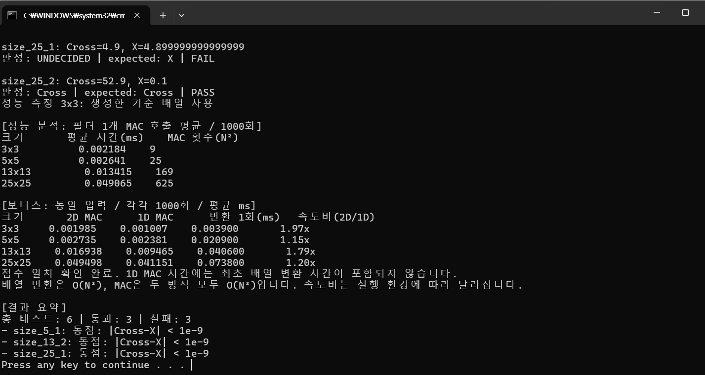
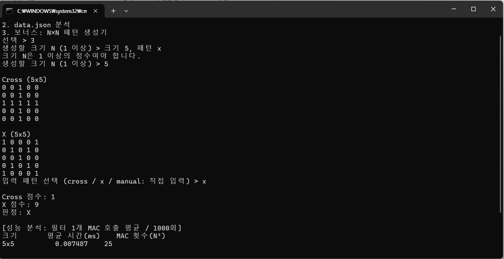
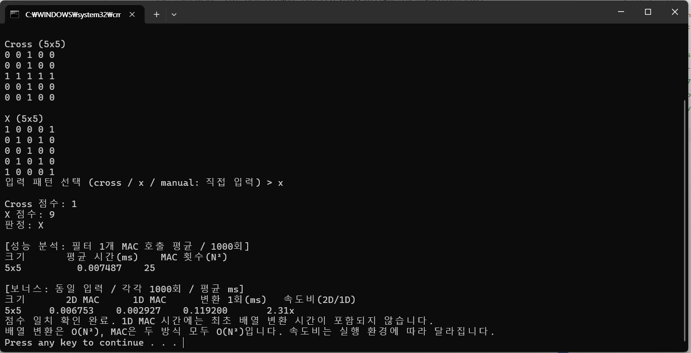

# 미션 3: Mini NPU Simulator

입력 패턴과 두 필터를 위치별로 곱하고 더하는 MAC 연산으로 비교하는 Python 콘솔 프로그램입니다.
Python 3.8 이상과 표준 라이브러리만 사용합니다. 필수 기능과 보너스 두 항목을 구현했습니다.

## 실행 방법

이 폴더에서 터미널을 열고 실행합니다.

```powershell
python main.py
```

메뉴에서 1을 선택하면 3×3 필터 A, B와 패턴을 입력합니다.
각 배열은 공백으로 구분한 숫자 3개씩 총 3줄을 입력합니다.
잘못된 열 개수, 숫자가 아닌 값, NaN 또는 무한대를 입력하면 해당 행을 다시 입력합니다.
필터 저장 확인 후 패턴을 입력하고 두 점수, 판정, 평균 연산 시간을 확인합니다.

```powershell
python main.py --mode 1
python main.py --mode 2
python main.py --mode 2 --data data.json --repeats 1000
python main.py --mode 2 --data sample_data.json
```

기본 데이터 경로는 작업 디렉터리와 관계없이 main.py와 같은 폴더의 data.json입니다.
--data로 지정한 상대 경로는 명령을 실행한 디렉터리를 기준으로 해석합니다.
data.json은 사용자가 제공한 원본을 수정 없이 복사한 파일입니다.
sample_data.json은 개발 중 생성한 별도의 6개 정상 예제이며 공식 데이터가 아닙니다.
반복 횟수 기본값은 1000회이며 최소 10회입니다.
종료 코드는 전체 PASS일 때 0, FAIL 또는 빈 패턴 집합일 때 1, 파일/입력 오류일 때 2입니다.
FAIL이 있어도 남은 케이스 분석과 성능 표, 최종 요약은 끝까지 출력합니다.

Windows에서는 Python 3.8 이상을 설치한 뒤 run.cmd를 실행하거나 위 명령을 사용하세요.
메뉴 2를 선택하면 제공 데이터를 분석합니다.

## 입력 예제

필터 A:

```text
0 1 0
1 1 1
0 1 0
```

필터 B 및 입력 패턴:

```text
1 0 1
0 1 0
1 0 1
```

예상 결과는 A 점수 1.0, B 점수 5.0, 판정 B입니다. 시간은 실행 환경에 따라 달라집니다.

## 구현 요약

- validate_matrix: N×N 크기와 유한한 숫자 여부를 검증합니다. 불리언은 숫자로 허용하지 않습니다.
- mac_score: 이중 반복문으로 같은 위치의 값을 곱해 누적합니다. 호출 전에 입력을 검증합니다.
- normalize_label: expected의 +와 필터 키 cross를 Cross로, x를 X로 정규화합니다.
- decide: abs(score_a - score_b) < 1e-9이면 UNDECIDED로 처리합니다. 경계값 1e-9는 동점에 포함하지 않습니다.
- analyze_data: size_{N}_{idx} 키에서 N을 추출하고 해당 크기의 필터를 선택합니다.
- 필터 오류는 같은 크기의 케이스에 FAIL로 기록하고 다른 크기의 분석은 계속합니다.
- 패턴 키, 스키마, 크기, 라벨, 수치 오류는 케이스별 실패 사유로 기록합니다.
- benchmark: 파일 읽기, 입력 검증, 화면 출력을 제외하고 MAC 함수 호출을 반복 측정합니다.
- 성능 표는 필터 1개당 N²회의 곱셈-누적을 기준으로 합니다. 두 필터 판정은 2N²회입니다.
- 해당 크기의 유효한 패턴이 없으면 생성한 Cross 배열을 성능 측정에 사용하고 이를 화면에 표시합니다.

데이터 구조:

```text
filters
  size_5 / size_13 / size_25
    cross: N×N 숫자 배열
    x: N×N 숫자 배열
patterns
  size_{N}_{idx}
    input: N×N 숫자 배열
    expected: "+" 또는 "x"
```

## 결과 리포트

2026-11-16, 제공된 data.json을 --mode 2 --repeats 1000으로 실행한 결과입니다.

| 케이스 | Cross 점수 | X 점수 | 판정 | 정규화한 expected | 결과 |
|---|---:|---:|---|---|---|
| size_5_1 | 0.9 | 0.8999999999999999 | UNDECIDED | X | FAIL |
| size_5_2 | 8.9 | 0.1 | Cross | Cross | PASS |
| size_13_1 | 0.3 | 14.70000000000001 | X | X | PASS |
| size_13_2 | 7.499999999999997 | 7.5 | UNDECIDED | Cross | FAIL |
| size_25_1 | 4.9 | 4.899999999999999 | UNDECIDED | X | FAIL |
| size_25_2 | 52.9 | 0.1 | Cross | Cross | PASS |

1. 전체 6개 중 통과 3개, 실패 3개이며 합계가 일치합니다.
2. 실패 케이스는 size_5_1, size_13_2, size_25_1입니다.
3. 세 케이스 모두 Cross 점수와 X 점수의 차이가 1e-9보다 작습니다.
4. 따라서 과제의 허용오차 정책을 적용하면 모두 UNDECIDED입니다.
5. expected는 각각 X, Cross, X이므로 판정과 일치하지 않아 FAIL입니다.
6. 원본의 소수를 Decimal로 읽어 별도 교차 확인하면 두 점수가 각각 0.90, 7.50, 4.90으로 정확히 같습니다.
7. 그러므로 이 실패는 부동소수점 오차만 없앤다고 해소되지 않으며 두 필터가 구분하지 못하는 동점 입력입니다.
8. Decimal 계산은 진단용 교차 확인에만 사용했고 제출 프로그램은 반복문 기반 float MAC을 사용합니다.
9. epsilon 없이 단순 대소 비교를 하면 미세한 표현 오차 때문에 근거 없는 승자를 선택할 수 있습니다.
10. expected에 맞추려고 동점 판정을 바꾸거나 데이터 값을 수정하지 않았습니다.
11. 라벨은 +를 Cross로, x를 X로 정규화하므로 표기 차이로 인한 오판정을 방지합니다.
12. 제공 데이터에는 크기나 스키마 오류가 없으며 이런 오류는 별도의 자동 테스트에서 확인했습니다.
13. 한 필터 MAC은 N개 행 각각에서 N개 열을 순회하므로 시간 복잡도는 O(N²)입니다.
14. 두 필터를 비교해도 2N²이므로 점근적 시간 복잡도는 O(N²)입니다.
15. 입력 배열의 저장 공간은 O(N²)이고 MAC 계산에 추가되는 누적 변수와 인덱스 공간은 O(1)입니다.
16. 성능 측정은 검증된 배열로 MAC 함수 한 번을 준비 호출한 뒤 1000회를 측정해 평균을 냅니다.
17. 3×3은 생성한 Cross 기준 배열, 나머지는 크기별 첫 유효 패턴과 Cross 필터를 사용했습니다.
18. 시간에는 함수 호출 및 반복문 비용이 포함되며 작은 배열에서는 고정 비용의 영향이 큽니다.
19. CPU 부하와 실행 환경에 따라 측정 시간이 달라지므로 시간 비율이 N² 비율과 정확히 같을 필요는 없습니다.
20. 실제 N² 증가와 함께 평균 시간이 증가하는 경향을 확인했으며 한 번의 측정으로 정밀한 성능 차이를 단정하지 않습니다.

| 크기 | 평균 시간(ms), 1000회 | MAC 횟수 N² |
|---|---:|---:|
| 3×3 | 0.001670 | 9 |
| 5×5 | 0.002830 | 25 |
| 13×13 | 0.012874 | 169 |
| 25×25 | 0.039810 | 625 |

위 시간은 현재 PC에서 기록한 한 번의 측정 결과이며 재실행 값은 달라집니다.
공식 데이터의 FAIL 3개는 프로그램 예외나 테스트 코드 실패와 구별해야 합니다.

## 검증

이 저장소 폴더에서:

```powershell
python -m unittest -v test_main
```

15개 테스트가 기본 MAC 점수, epsilon 경계, 라벨 정규화, 5/13/25 크기, 잘못된 입력 재시도,
잘못된 JSON 항목 이후의 분석 지속, 필터 오류의 크기별 격리, 동점/오답 처리,
제공 데이터의 실제 판정과 기존 두 콘솔 모드 실행을 검증합니다.
보너스 검증은 생성 배열의 모양과 짝수 N 정책, 잘못된 N 재입력, 행 우선 변환 순서,
공식 데이터 전체의 2D/1D 점수 및 판정 일치, 양쪽 측정의 동일 반복 횟수를 포함합니다.
생성기 CLI, 생성 필터를 재사용한 모드 1, 생성 필터와 직접 입력 패턴의 조합도 실행 검증합니다.

## 보너스 1: 1차원 배열과 성능 비교

flatten은 행 우선 순서로 N×N 배열을 길이 N²의 리스트로 바꿉니다.
예를 들어 [[1, 2], [3, 4]]는 [1, 2, 3, 4]가 됩니다.
mac_score_flat은 한 번의 반복문과 1차원 인덱스로 접근합니다.
기존 이중 반복문과 곱셈 및 누적 순서를 같게 유지합니다.
모든 모드의 성능 표 뒤에 같은 입력과 같은 반복 횟수로 비교 표를 출력합니다.
비교 전에 두 함수의 점수가 정확히 같은지 확인하며, 다르면 오류로 처리합니다.
공식 데이터의 6개 패턴과 각 2개 필터에 대해서도 점수 및 판정 일치를 자동 검증했습니다.

2026-11-16, 공식 데이터 모드에서 각 방식 1000회 측정한 한 번의 실행 결과:

| 크기 | 2D MAC 평균(ms) | 1D MAC 평균(ms) | 배열 두 개 변환 1회(ms) | 속도비 2D/1D |
|---|---:|---:|---:|---:|
| 3×3 | 0.001454 | 0.000717 | 0.003300 | 2.03배 |
| 5×5 | 0.002090 | 0.001263 | 0.004400 | 1.65배 |
| 13×13 | 0.011233 | 0.006933 | 0.017400 | 1.62배 |
| 25×25 | 0.039552 | 0.033291 | 0.084500 | 1.19배 |

3×3은 생성한 Cross 배열을 사용하고 나머지는 크기별 첫 유효 패턴과 Cross 필터를 사용했습니다.
양쪽 측정에서 준비 호출을 1회씩 수행하고 I/O를 제외했습니다.
1D MAC 평균은 이미 변환한 배열을 재사용하는 조건이며 배열 변환 비용은 포함하지 않습니다.
배열 변환은 별도 열에 한 번의 실측 시간으로 표시하며 짧은 단발 측정이라 잡음의 영향이 큽니다.
한 번만 연산하면 변환 비용 때문에 전체 시간이 더 길어질 수 있습니다.
반복 재사용 시 총비용은 대략 변환 시간 + 반복 횟수 × 1D MAC 평균 시간입니다.
양쪽 연산은 여전히 O(N²)이며 차이는 중첩 인덱싱과 반복문 비용 감소에 있습니다.
기존 2D 배열을 보존하면서 1D 리스트도 만들므로 추가 저장 공간은 O(N²)입니다.
Python 리스트는 숫자 객체의 참조를 저장하므로 이 결과로 하드웨어 캐시 효과나 메모리 절약을 단정하지 않습니다.
이번 측정에서 속도 개선을 확인했지만 CPU 부하와 인터프리터 환경에 따라 달라집니다.

## 보너스 2: N×N 패턴 생성기

run.cmd를 실행하고 메뉴 3을 선택하면 N을 입력해 Cross와 X를 생성할 수 있습니다.
생성된 두 배열을 출력한 다음 cross, x 또는 manual을 선택합니다.
cross/x를 고르면 생성한 패턴을 입력으로 사용하며 manual은 직접 N줄을 입력받습니다.
생성 필터로 점수를 계산하고 판정, 성능 표, 2D/1D 비교 표를 출력합니다.

```powershell
python main.py --mode 3
python main.py --mode 3 --size 7 --pattern x
python main.py --mode 3 --size 13 --pattern cross --repeats 1000
python main.py --mode 3 --size 5 --pattern manual
```

N은 1 이상의 정수입니다. 홀수 N의 Cross는 가운데 행과 열이 1입니다.
짝수 N에는 유일한 중앙 행/열이 없으므로 0부터 시작하는 인덱스 N//2의 행과 열을 사용합니다.
X는 주대각선과 반대각선이 1입니다.
N=1 등에서는 두 패턴이 겹쳐 구별되지 않을 수 있으며 이 경우에도 동점 규칙을 그대로 적용합니다.
직접 입력 시 행당 N개 숫자를 검증하며 잘못된 행만 다시 입력받습니다.

모드 1에서도 생성기를 재사용할 수 있습니다.

```powershell
python main.py --mode 1 --generated-filters
```

이때 A=Cross, B=X인 3×3 필터를 자동으로 준비하고 패턴 3줄만 입력받습니다.
기존 모드 1 기본 실행은 과제 요구대로 필터 A, B와 패턴을 모두 직접 입력받습니다.
성능 측정에서 유효 패턴이 없는 크기를 보완할 때도 같은 생성 함수를 재사용합니다.


## 실제 실행 화면 캡처

아래 사진은 사용자가 직접 실행한 콘솔 화면의 원본 캡처입니다.
측정 시간은 실행할 때마다 달라질 수 있으므로 앞의 성능 표와 수치 차이가 있습니다.
README.md와 captures 폴더를 같은 폴더에 두면 사진을 함께 확인할 수 있습니다.

### 1. 실제 데이터 분석, 성능 측정 및 최적화 비교

3×3, 5×5, 13×13, 25×25의 평균 연산 시간과 2D/1D 비교 결과입니다.
전체 6개 케이스 중 PASS 3개, FAIL 3개가 확인됩니다.
실패한 size_5_1, size_13_2, size_25_1은 허용오차 정책에 따른 동점 판정이며,
데이터를 수정하거나 expected에 맞춰 판정을 변경하지 않았습니다.



### 2. 크기 입력 검증과 5×5 패턴 생성

크기에 숫자가 아닌 문자열을 입력하면 안내 후 재입력을 받습니다.
숫자 5를 다시 입력하자 5×5 Cross와 X 패턴이 생성됐으며, 입력 패턴으로 x를 선택했습니다.



### 3. 생성 패턴 판정과 최적화 결과

생성한 X 패턴의 Cross 점수는 1, X 점수는 9이며 최종 판정은 X입니다.
동일 입력을 각 1000회 측정한 이 실행에서는 2D MAC 0.006753ms,
1D MAC 0.002927ms로 약 2.31배의 속도비를 기록했습니다.
최초 배열 변환 0.119200ms는 1D MAC 평균에서 제외해 별도로 표시했습니다.
변환 전후의 점수 일치도 확인했습니다.



위 세 장은 사용자가 직접 촬영한 실제 콘솔 캡처입니다.
